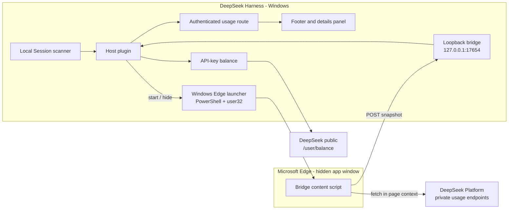

# Token Usage Dashboard for Windows

[](LICENSE)
[](docs/architecture.md)
[](package.json)
[](edge-bridge/README.md)

Official and local DeepSeek usage, spend, balance, API keys, and models in a
persistent DeepSeek Harness footer, with a Windows-native automatic Edge launch.

This repository is the Windows port of
[token-usage-dashboard](https://github.com/huaqing0617-wang/token-usage-dashboard).
The macOS launch path is retained, but the development, testing, and documented
behaviour target Windows 10/11.

## Overview

Token Usage Dashboard adds a full-width status bar to DeepSeek Harness and keeps
two independent accounts of model usage:

- **Official Platform** — the account-wide DeepSeek Platform ledger across all
  API keys, including request counts, spend, balance, per-key usage, and model
  totals. Platform data is account-scoped; it does not expose a device identity.
- **Local DSH** — this machine's durable Session logs and a USD list-price
  estimate, including the local provider and model registry.

The official view is fed by a small Edge content script. DeepSeek's Platform
usage endpoints are protected by an AWS WAF JavaScript challenge; a valid saved
token still receives `202 x-amzn-waf-action: challenge`. The bridge runs the
request inside the signed-in Platform page, where the browser has already solved
the challenge, and posts only the resulting metrics to a loopback Host route.

On Windows the Host can also keep that browser context alive by itself: when no
official snapshot has arrived, it starts Microsoft Edge in a hidden collection
window or reuses an existing Platform window. The details panel reports what the
launcher did, including failures.

> **Status: Windows port, locally verified.** The Windows launcher was exercised
> live on Windows 10 22H2 (edge discovery, hidden app-window launch, reuse,
> cleanup). The loopback bridge and dashboard are covered by the test suite. The
> official extension had not been loaded in Edge during this port's verification,
> so a full live Platform sync on Windows is still listed as unverified in
> [Verification](docs/verification.md).

## Architecture



The official and local planes are deliberately separate: the footer prefers the
official ledger when the bridge is fresh and falls back to local DSH values
otherwise. See [Architecture](docs/architecture.md) for the endpoint, launch, and
failure model.

## Capabilities

- Persistent `shell.bottom` footer with today's tokens/spend, balance, all-time
  spend/tokens, and the connected API/model count.
- Expandable details for official today/all-time totals, request counts,
  per-key usage, all-time model usage, balance, and the local DSH breakdown.
- Official bridge refreshes current usage about every 30 seconds; the Host UI
  polls every 5 seconds. All-time history is collected in consecutive 30-day
  windows and filled progressively.
- Balance fallback through the Harness credential service and the public
  DeepSeek `/user/balance` endpoint when the bridge is unavailable.
- Always-on switch persisted in browser `localStorage`; the collapsed state
  leaves a compact launcher.
- **Windows automatic Edge context** — reuses an open Platform window, or starts
  Edge as a separate app window and hides it through Win32, so it does not add a
  tab to the user's browsing window and does not steal focus. One attempt per
  Host session; the result is visible in the details panel.
- **Windows Edge discovery** — `DSH_EDGE_PATH`, the App Paths registry keys, and
  the standard per-machine/per-user install directories for the stable, Beta,
  and Dev channels.
- No administrator rights and no UAC prompt: Edge runs in the signed-in user's
  default profile.

## Quick Start

### Prerequisites

- Windows 10 or 11 (x64). Tested with DeepSeek Harness desktop `0.2.2-rc.1`.
- Microsoft Edge, signed in to `https://platform.deepseek.com`.
- Windows PowerShell 5.1 (included with Windows) for the hidden-window launch.
- Node.js 24 only for the test suite; the runtime uses the Harness runtime.

### Install the DSH bundle

From a PowerShell prompt in this checkout:

```powershell
git clone https://github.com/huaqing0617-wang/token-usage-dashboard-win.git
cd token-usage-dashboard-win
dsh plugin --profile desktop add "link:$PWD"
```

Select the new bundle in the DSH plugin manager if it is not selected
automatically, then restart the DSH window once. The Host half (local scan and
bridge) only reloads on a DSH restart.

### Install the Edge bridge once

1. Open `edge://extensions`.
2. Enable **Developer mode**.
3. Choose **Load unpacked** and select the `edge-bridge/` directory in this
   checkout.
4. Reload the `https://platform.deepseek.com/usage` tab once, or let DSH start
   the hidden Edge window.
5. Restart DSH. The footer should move from `Local` to `Official` within one
   sync cycle.

The extension runs only on `platform.deepseek.com` and posts only to
`127.0.0.1:17654`. It does not export cookies or the Platform user token to
another server.

### Check the Windows launcher

```powershell
node scripts/verify-official-browser.mjs           # inspect Edge path and windows
node scripts/verify-official-browser.mjs --launch  # start and hide Edge for real
```

The dry run prints the resolved `msedge.exe`, the number of Edge windows, and how
many already show DeepSeek. `--launch` performs the same steps as the Host and
leaves the hidden window running so the dashboard can collect; close Edge or
restart the machine to remove it.

## How the Windows launch works

About 35 seconds after plugin activation, if no official snapshot has arrived:

1. Enumerate top-level `Chrome_WidgetWin_1` windows owned by `msedge.exe`.
2. If a window already shows DeepSeek, reuse it and do not spawn another Edge
   process. This makes repeated DSH restarts idempotent.
3. Otherwise resolve `msedge.exe` (`DSH_EDGE_PATH` → App Paths registry → known
   install directories).
4. Start Edge detached with:

   ```text
   --app=https://platform.deepseek.com/usage
   --window-size=1024,768
   --no-first-run --no-default-browser-check
   --disable-background-timer-throttling
   --disable-renderer-backgrounding
   --disable-backgrounding-occluded-windows
   --disable-features=CalculateNativeWinOcclusion
   ```

5. Wait up to 20 seconds for the new app window, verify that it is new (it did
   not exist before the launch) and looks like an app window (a browser window
   carries the `- <profile> - Microsoft Edge` suffix; the app window does not),
   then hide it with `ShowWindowAsync(SW_HIDE)`.
6. Report `hidden`, `reused`, `visible` (started but could not hide), `no-edge`,
   `failed`, `disabled`, or `unsupported` in the details panel.

The attempt is intentionally limited to once per Host session. Reopening a
window the user closed would be intrusive and would fight the user's browser.

To opt out (for locked-down machines or CI):

```powershell
$env:DSH_TOKEN_USAGE_NO_AUTO_LAUNCH = '1'
```

To pin a non-standard Edge location:

```powershell
$env:DSH_EDGE_PATH = 'D:\Portable\Edge\msedge.exe'
```

## Repository Map

| Path | Role |
|---|---|
| `index.js` | Host plugin: local scan, live event ingest, API-key balance, Host model registry, bridge state, automatic browser status, authenticated route |
| `official-browser.js` | Windows Edge discovery, app-window launch, Win32 hide, macOS launch parity, status reporting |
| `client.js` | Browser UI: footer, official/local details, auto-launch status, always-on switch, styles |
| `usage.js` | Local token accounting, inherited-event exclusion, day buckets |
| `pricing.js` | Local USD estimate, peak/off-peak rule, 2026 holiday table |
| `bridge.js` | Loopback ingest server and snapshot validation |
| `edge-bridge/` | Manifest V3 Edge extension |
| `edge-bridge/content.js` | Current-window and all-time 30-day-window collector, balance, bridge POST; starts even when the document is hidden |
| `scripts/verify-official-browser.mjs` | Windows diagnostic for Edge discovery and hidden launch |
| `docs/architecture.md` | Data flow, endpoints, failure states, automatic Edge lifecycle |
| `docs/verification.md` | Test matrix, live evidence, and unverified paths |
| `SECURITY.md` | Data boundaries and private vulnerability reporting |
| `CONTRIBUTING.md` | Contribution and local-verification expectations |
| `test/` | Node smoke tests for the client, extension, bridge, and launcher |

## Verification

```powershell
npm test
```

The suite covers syntax checks, Edge path/registry resolution, launch flags,
PowerShell script construction and injection resistance, launcher state
transitions, the 5-second UI refresh, official/local rendering including the
Windows auto-launch line, the collapsed launcher, the bridge token/CORS/
normalization path, and the extension's current-window plus rolling all-time
aggregation in both visible and hidden documents.

Live evidence, commands, and the items that remain unverified are recorded in
[docs/verification.md](docs/verification.md). In particular:

- The Windows hidden-window launch was observed live: Edge appeared as an app
  window titled `DeepSeek Platform`, was hidden, and could be closed cleanly.
- The official bridge and badge were observed live on the macOS original.
- The Windows end-to-end official sync was not repeated because the unpacked
  extension was not installed in Edge during this port.
- No GitHub Actions workflow is included, so there is no CI badge or claim.

## Troubleshooting (Windows)

| Symptom | Check |
|---|---|
| Details show `未找到 Microsoft Edge` / `no Edge` | Set `DSH_EDGE_PATH` to the real `msedge.exe`; confirm the App Paths registry key exists |
| Details show `自动拉起失败` / failed | Enterprise policy may block `Add-Type`/PowerShell. Open `https://platform.deepseek.com/usage` manually |
| A visible Edge window appears | Window hiding is best-effort; the window is a normal Edge app window and can be closed. Check the status line in details |
| Footer stays on `Local` | Load `edge-bridge/` in `edge://extensions`, reload the Platform tab, and restart DSH |
| `127.0.0.1:17654` already in use | Another DSH window is running the bridge. Close it or use one DSH window |
| Official data stops updating | The hidden Platform window may have been closed. Restart DSH, which makes one new attempt |

## Limitations and Roadmap

- **Edge remains required.** DSH can start or hide it, but the Platform WAF
  context is a browser context. A pure DSH-only implementation would need an
  embedded browser layer and is not part of this version.
- **Private endpoints.** The Platform usage API is not a documented public API;
  its responses may change. The collector fails closed to local data.
- **Update cadence.** The UI polls every 5 seconds, but official Platform data is
  fetched about every 30 seconds. Five-second Platform polling is intentionally
  not used because it is more likely to trigger the WAF and exceed the Platform's
  own update cadence.
- **All-time scan.** History is assembled from consecutive 30-day windows,
  stopping after three empty windows (maximum 48 windows). The first scan may
  take minutes and is shown as a syncing notice.
- **One launch attempt per Host session.** A hidden window that is closed later
  is not recreated automatically; the official plane becomes stale and falls
  back to local values until DSH restarts or the Platform page is opened.
- **No CI workflow.** Tests are reproducible locally; no workflow has been
  executed.

## Contributing

Open an issue before changing a data source or the official collector, then run
`npm test`. See [CONTRIBUTING.md](CONTRIBUTING.md) for the scope and security
checklist.

## Security

Browser credentials stay in the Platform page. The bridge accepts only loopback
traffic with a local ingest token, and the Host never exposes the Platform token
to the client. The Windows launcher starts Edge in the user's own profile and
only enumerates windows owned by `msedge.exe`; it does not read cookies or
browser storage. See [SECURITY.md](SECURITY.md) for data boundaries and
vulnerability reporting.

## License and Acknowledgements

Released under the [MIT License](LICENSE).

This project is a Windows port of
[huaqing0617-wang/token-usage-dashboard](https://github.com/huaqing0617-wang/token-usage-dashboard).
DeepSeek Harness and DeepSeek Platform are products of DeepSeek. This project is
not affiliated with or endorsed by DeepSeek. It relies on private Platform
dashboard endpoints that may change without notice.

References:

- [DeepSeek Models & Pricing](https://api-docs.deepseek.com/quick_start/pricing/)
- [Get User Balance](https://api-docs.deepseek.com/api/get-user-balance/)
- [2026 State Council holiday notice](https://www.gov.cn/gongbao/2025/issue_12406/202511/content_7048922.html)
