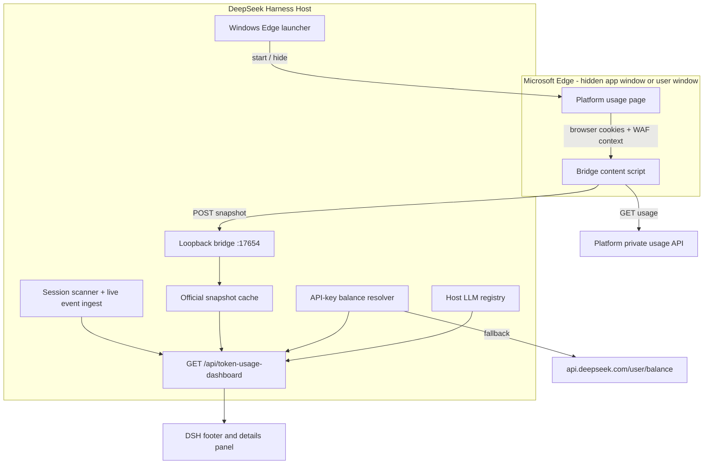

# Architecture

## Purpose

The dashboard has two independent data planes. They answer different questions
and are intentionally not merged into one number:

| Plane | Source | Scope | Currency |
|---|---|---|---|
| Official | DeepSeek Platform private usage endpoints, fetched inside the signed-in Edge page | All API keys on the account; usage may originate from any device | Platform currency, normally CNY |
| Local | DSH durable Session logs on this machine | This DSH profile only | USD estimate at published list prices |

The footer prefers the official plane when the bridge snapshot is fresh. Local
values remain available when the bridge is disconnected and provide the DSH-only
breakdown.

## Data Flow

## Official Collection

The content script runs only on `https://platform.deepseek.com/*` and uses the
existing Platform web session. It fetches:

| Endpoint | Use |
|---|---|
| `GET /api/v0/users/get_user_summary` | Recharge and bonus wallet balances |
| `GET /api/v0/usage/by_api_key/amount` | Tokens and request counts for one 30-day window |
| `GET /api/v0/usage/by_api_key/cost` | Spend and per-key cost for one 30-day window |

A current 30-day window is fetched every 30 seconds. The all-time history is
assembled backwards in consecutive 30-day windows:

1. Merge the current window.
2. Move the window end back 30 days and fetch the previous window.
3. Continue until three consecutive windows contain no tokens, requests, or
   cost, or until the 48-window safety cap (four years) is reached.
4. Post a preliminary snapshot, then progressively richer snapshots, then a
   final snapshot marked complete.

Each window and each parsed aggregate is written to `chrome.storage.local` with
a six-hour cache. A window that still receives a WAF challenge is retried with
exponential backoff and reported in a bounded `syncErrors` list.

The collector starts even when `document.visibilityState` is `hidden`. This is
required on Windows, where the Host deliberately hides the Edge window. A
visibility change to `visible` merely triggers an extra refresh; the 30-second
loop is independent of it.

### Why Not the Monthly Aggregate Endpoints?

The Platform also exposes monthly aggregate paths. In the first live run those
paths returned `202 x-amzn-waf-action: challenge` for older months, while the
by-key 30-day path succeeded. The collector therefore uses the endpoint already
proven in this browser context instead of a partly blocked monthly path.

### Why a Browser Bridge?

Direct requests from the DSH Host, even with a valid Platform user token, are
challenged by AWS WAF. The missing ingredient is a real browser page that has
already executed the challenge and carries the browser's Platform context. The
extension runs there and posts only derived metrics to loopback. It does not
send the Platform token to DSH.

## Automatic Edge Context

The Host makes one best-effort attempt when no bridge snapshot has arrived 35
seconds after plugin activation. The status of that attempt is included in the
dashboard payload (`autoLaunch`) and rendered in the details panel.

### Windows

1. **Probe.** A generated PowerShell script declares a small `user32.dll`
   P/Invoke shim, enumerates top-level windows, and keeps only
   `Chrome_WidgetWin_1` windows whose process is `msedge.exe`. It reports the
   handles, the window count, and how many titles match DeepSeek.
2. **Reuse.** If a Platform window already exists, the launcher records
   `reused` and does not start another Edge process. The existing content script
   keeps posting, and repeated DSH restarts do not pile up windows.
3. **Resolve.** `msedge.exe` is resolved from `DSH_EDGE_PATH`, then the
   `App Paths\msedge.exe` registry keys (`HKLM`, `HKCU`, `WOW6432Node`), then
   the standard `Program Files`, `Program Files (x86)`, `ProgramW6432`, and
   `LOCALAPPDATA` locations for the stable, Beta, and Dev channels.
4. **Launch.** Edge starts detached with an app window for the Platform usage
   page. `--app` is the key Windows adaptation: it creates a separate top-level
   window instead of adding a tab to the user's existing browser window, so the
   window can be hidden without touching the user's session. Background timer
   throttling, renderer backgrounding, and native occlusion calculation are
   disabled so the hidden page keeps collecting.
5. **Hide.** A second PowerShell script waits up to 20 seconds for a window that
   is new since the probe, visible, and shaped like an app window (a normal
   browser window ends with `- <profile> - Microsoft Edge`; the `--app` window
   does not). It calls `ShowWindowAsync(hwnd, SW_HIDE)` and verifies
   `IsWindowVisible` is false before reporting `hidden`. Windows owned by other
   processes and windows that existed before the launch are never touched.
6. **Report.** The result is one of `hidden`, `reused`, `visible`, `no-edge`,
   `failed`, `disabled`, or `unsupported`, with a short detail string.

The launcher is inert unless the Host is on Windows. It requires no elevation,
writes no registry keys, changes no Edge settings, and uses the user's default
Edge profile so the Platform session is reused.

Failure handling is fail-soft: if PowerShell or `Add-Type` is blocked by
enterprise policy, the launch is reported as `failed` and the dashboard keeps
using local data plus the manual `打开 Platform 账单` link. The hidden window is
not closed by DSH; it is a normal Edge window that ends with the browser.

### macOS (retained)

The original path is unchanged: if Edge is running, `open -g -a "Microsoft
Edge"` opens a background tab; otherwise Edge is started with background
throttling disabled and hidden through `osascript`. The Windows launcher shares
the same one-attempt policy and status surface.

### Why One Attempt?

Repeatedly forcing tabs, unhiding a browser, or recreating a window the user
closed would be intrusive. One attempt per Host session is predictable and
matches the original macOS design. A stale official plane still falls back to
local values, and the details panel explains how to reopen it.

## Freshness and Failure States

| State | Meaning | UI behavior |
|---|---|---|
| `ready` | Snapshot received within two minutes | Official badge and values |
| `stale` | Last snapshot is older than two minutes | Last official values plus a sync warning |
| `disconnected` | No snapshot | Local values and bridge setup guidance |
| `complete: false` | All-time window scan is still running or had failed windows | Syncing notice; partial official totals |
| `syncErrors` | One or more window reads failed | Bounded error count and first three entries |

The auto-launch status is separate from the bridge state:

| `autoLaunch.state` | Meaning |
|---|---|
| `idle` | Not attempted yet |
| `launching` | Probe or launch in progress |
| `hidden` | Edge started and the new app window was hidden |
| `reused` | An existing Platform window is already open |
| `visible` | Edge started, but the new window could not be identified or hidden |
| `no-edge` | `msedge.exe` was not found |
| `failed` | Enumeration, PowerShell, or spawn failed |
| `disabled` | `DSH_TOKEN_USAGE_NO_AUTO_LAUNCH=1` |
| `unsupported` | Non-Windows/macOS platform |

The 5-second UI interval is independent of the 30-second official fetch. This
keeps local counters responsive without multiplying WAF-sensitive requests.

## Runtime Dependencies

- Node/Harness runtime plus `node:child_process`, `node:fs`, and `node:path`
  (built in).
- Windows PowerShell 5.1 (`powershell.exe`) for window enumeration and hiding;
  `pwsh.exe` is accepted as a fallback. No modules are installed.
- `user32.dll` `EnumWindows`, `GetWindowText`, `IsWindowVisible`, and
  `ShowWindowAsync`, reached through an in-memory `Add-Type` shim.

## Security Boundaries

- The Platform page token and cookies remain in the browser.
- The bridge listens only on `127.0.0.1:17654`.
- The bridge requires a local ingest token and allows the Platform origin and
  extension origins.
- The authenticated dashboard route is protected by the DSH connection service.
- API-key balance resolution happens in the Host; the key is never sent to the
  client.
- The bridge snapshot contains usage aggregates and wallet balances, not
  credentials.
- The Windows launcher only enumerates windows owned by `msedge.exe`, only
  passes fixed arguments plus the Platform URL, and never reads browser storage.
